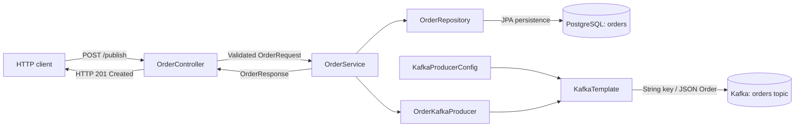
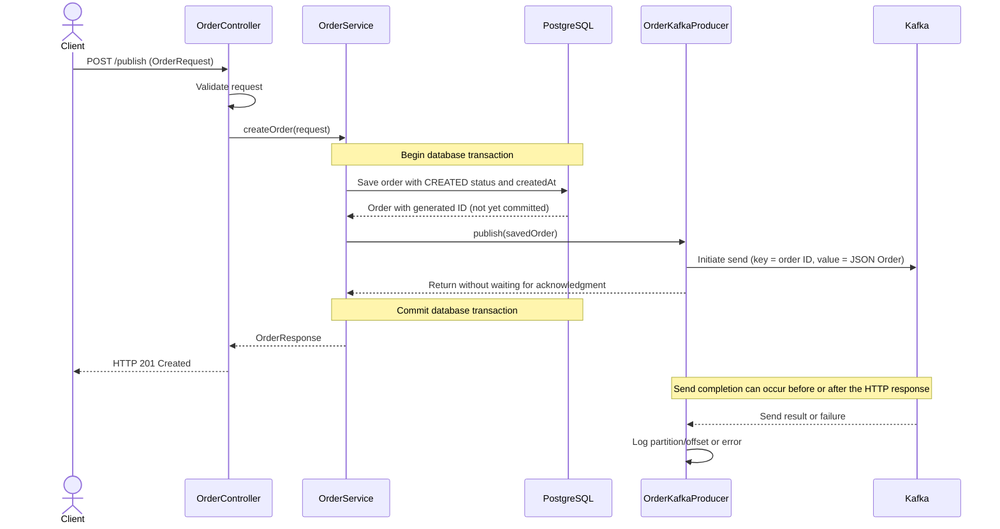

# Kafka Order Service

Producer-only Spring Boot 3 / Java 21 application. `POST /publish` saves an order in PostgreSQL and asynchronously publishes the saved `Order` as JSON to Kafka topic `orders`.

## Architecture



| Component | Responsibility |
| --- | --- |
| `OrderController` | Accepts requests on port `8081`, validates input, and returns the created order. |
| `OrderService` | Creates the order, saves it within a database transaction, and initiates Kafka publication. |
| `OrderRepository` / `Order` | Maps orders to the PostgreSQL `orders` table using Spring Data JPA and a generated ID. |
| `OrderKafkaProducer` | Sends the saved order with its ID as the record key and logs send success or failure. |
| `KafkaProducerConfig` | Supplies the `KafkaTemplate<String, Order>` using the configured producer factory. |
| PostgreSQL / Kafka | Store order data in `kafka_order_db` on port `5432` and receive events on port `9092`, respectively. |

This application provides the producer only. Downstream consumers can subscribe to the `orders` topic independently.

## Functional flow



1. The client submits `productCode`, `productName`, `quantity`, and `price` to `POST /publish`.
2. Validation requires nonblank product code and name, a quantity of at least `1`, and a price of at least `0.01`. Invalid input receives HTTP `400` before order creation.
3. The service assigns status `CREATED` and the current local `createdAt` timestamp, then saves the order to obtain its database-generated ID.
4. The producer initiates a send to the topic configured by `app.kafka.topic` (`orders`). The record key is the ID as a string; the JSON payload contains the saved order, including `createdAt`. JSON type headers are disabled.
5. The service builds an `OrderResponse`, and its database transaction commits before the controller returns HTTP `201`. The response contains `id`, `productCode`, `productName`, `quantity`, `price`, and `status`.
6. The send callback logs the Kafka partition and offset on success or logs an error on failure. It does not update the order status or change an HTTP response already returned.

### Delivery and transaction behavior

Kafka uses `acks=all`, but the HTTP request does not wait for the send future to complete. HTTP `201` confirms successful order creation, not confirmed Kafka delivery.

The database transaction and Kafka send are separate operations. An asynchronous Kafka failure can leave a committed order without an event. Because sending starts before the database commit, an event can also be delivered before the order is committed, or even if the commit later fails. An exception thrown synchronously during send initiation propagates through the service and can roll back the database transaction. Atomic delivery would require an additional design such as a transactional outbox.

## Run locally

Create the database:

```sql
CREATE DATABASE kafka_order_db;
```

Get the Kafka Docker image:

```bash
docker pull apache/kafka:4.4.0
```

Start the Kafka Docker container:

```bash
docker run -p 9092:9092 apache/kafka:4.4.0
```

In another terminal, create a topic to store your events:

```bash
docker exec -it dazzling_lehmann /opt/kafka/bin/kafka-topics.sh --create --topic orders --bootstrap-server localhost:9092
```

Replace `dazzling_lehmann` with your Kafka container's name from `docker ps`.

With PostgreSQL and Kafka running, start the application:

```bash
mvn spring-boot:run
```

Swagger UI is available at `http://localhost:8081/swagger-ui.html`.

Example request:

```json
{
  "productCode": "P1001",
  "productName": "Laptop",
  "quantity": 2,
  "price": 50000
}
```

Consume events:

```bash
kafka-console-consumer.sh --topic orders --from-beginning --bootstrap-server localhost:9092
```
